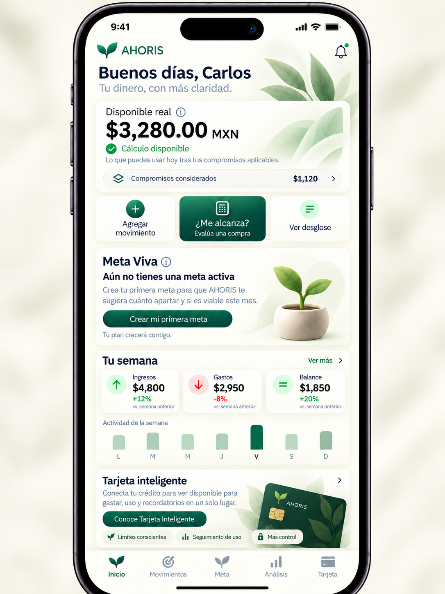
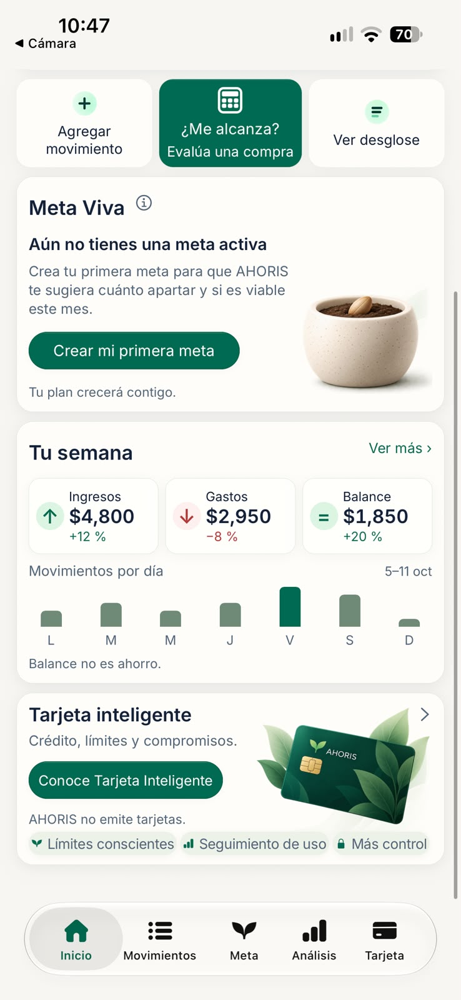
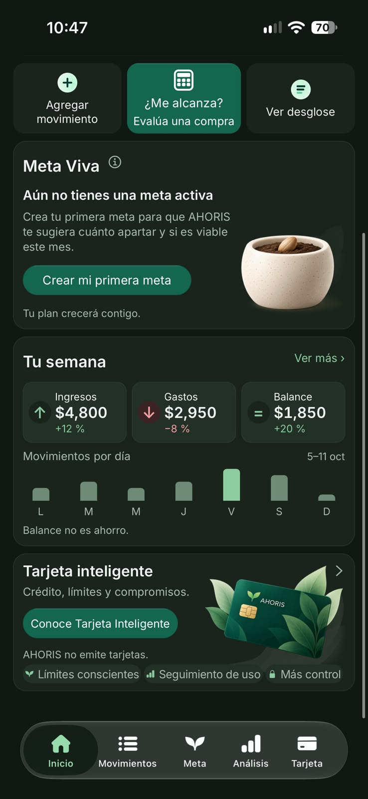
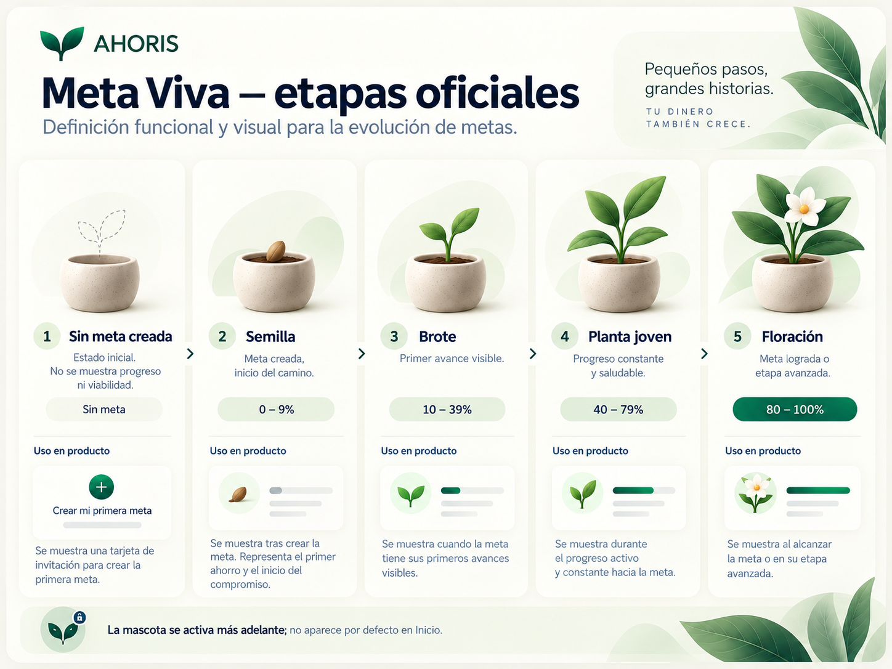
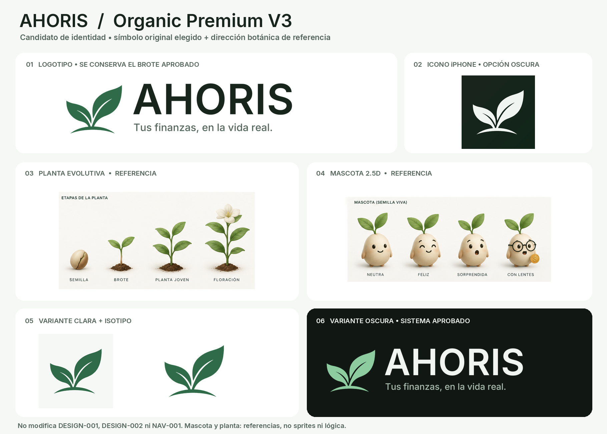
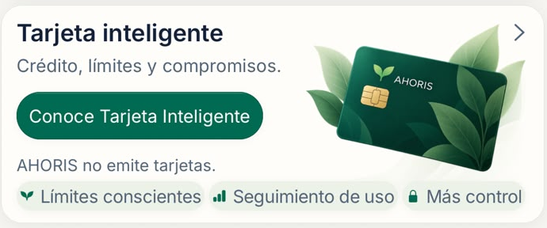

  
  <h1>AHORIS</h1>
  
<strong>Tus finanzas, en la vida real.</strong>

  
Finanzas personales adaptativas para México. iPhone-first, local-first.

  

    
    
    
    
    
    
  

  

    <a href="https://github.com/JosueLuceroG"><strong>Volver al perfil de GitHub</strong></a>
  

---

> [!IMPORTANT]
> AHORIS sigue en desarrollo. Este repositorio es un escaparate público: no incluye el código fuente, no hay demo pública y la app todavía no está publicada. La interfaz existe como preview en Expo Go; Inicio está aprobado visualmente, pero el motor financiero, la persistencia y el build nativo siguen pendientes. Las capturas usan datos ficticios de demostración.

## La app en iPhone

  

<strong>Inicio aprobado.</strong> Referencia visual del proyecto con marco de iPhone. Es un render conceptual aprobado, no una captura de producción.

La preview real se ve así en claro y oscuro:

<table>
  <tr>
    <td width="50%" valign="top">
      
       
      <strong>Claro.</strong> Captura real de la preview en Expo Go. Los importes son ficticios.
    </td>
    <td width="50%" valign="top">
      
       
      <strong>Oscuro.</strong> Captura real de la preview en Expo Go. Los importes son ficticios.
    </td>
  </tr>
</table>

La referencia visual muestra cinco destinos: Inicio, Movimientos, Meta, Análisis y Tarjeta. La navegación normal aceptada conserva tres: Inicio, Movimientos y Meta. La barra de cinco pestañas es una preview protegida, no la navegación de producción. Análisis y Tarjeta todavía no son módulos funcionales.

## Qué es AHORIS

AHORIS es una app de finanzas personales que aprende progresivamente la realidad financiera de una persona y adapta su plan cuando esa realidad cambia. Conecta el dinero disponible, los compromisos, las metas, el ahorro, las deudas y el comportamiento observado para explicar el impacto de una decisión.

No es solo un registro de gastos, un presupuesto, una app de ahorro, un gestor de tarjetas ni una app bancaria. Es una ayuda para decidir con contexto.

La pregunta central no es “¿cuánto saldo tengo?”, sino:

> **¿Qué puedes hacer con tu dinero sin romper lo que ya está comprometido ni lo que estás construyendo?**

AHORIS parte de una idea sencilla: el saldo de una cuenta no indica cuánto puede gastar una persona. Parte de ese dinero ya corresponde a compromisos, gastos esenciales, deudas, metas y un margen de seguridad. El plan debe adaptarse a la vida real, no al revés.

## Lo que la app contempla

| Función | Qué resuelve | Estado real |
| --- | --- | --- |
| **Disponible Real** | Separa el saldo del dinero realmente disponible después de compromisos, gastos esenciales, deudas, reservas y colchón. | Diseño aprobado; cálculo real pendiente. |
| **Movimientos** | Registra ingresos y gastos con monto, fecha, categoría, método de pago y origen. | Ruta provisional; registro real pendiente. |
| **Meta Viva** | Define una meta con un plan de ahorro que puede reajustarse cuando cambia la realidad. | Preview visual; lógica pendiente. |
| **Ahorro Adaptable** | Propone alternativas sostenibles ante un desvío, sin imponer un ajuste. | Documentado; no implementado. |
| **Simulador “¿Qué pasa si…?”** | Muestra el posible impacto de una compra o escenario sin registrar la operación. | Documentado; motor pendiente. |
| **“¿Me alcanza?”** | Evalúa una decisión con el contexto disponible y declara sus limitaciones. | Flujo de preview; motor pendiente. |
| **Resumen semanal** | Interpreta ingresos, gastos, balance y ahorro con el nivel de evidencia disponible. | Preview con datos ficticios. |
| **Aprendizaje financiero** | Detecta recurrencias y señales con madurez, sin afirmar patrones prematuros. | Documentado; no implementado. |
| **Tarjeta Inteligente** | Entiende el uso de crédito, límites y compromisos. El crédito disponible nunca se trata como dinero propio. | Semántica básica en el núcleo; módulo completo post-MVP. |
| **Agente AHORIS** | Acompañante conversacional personalizado, con herramientas de consulta y sin escritura financiera. | Objetivo central de V1; no implementado. |
| **Mascota botánica** | Representa al agente y acompaña el progreso real de la meta. No es decoración ni una métrica de riqueza. | Dirección conceptual; no implementada. |

La tabla describe el producto documentado y su estado real. No presenta funciones futuras como si ya existieran.

## Meta Viva y mascota

  

La planta representa hábitos, constancia y crecimiento personal hacia una meta. No mide riqueza acumulada ni castiga una situación financiera difícil. La secuencia visual es:

**Semilla → Brote → Planta joven → Floración**

La mascota es distinta de la planta y del isotipo: es una pequeña semilla viviente con dos hojas, apariencia 2.5D y expresiones discretas. Representa al Agente AHORIS. No aparece desde la primera instalación: se desbloquea con progreso real de Meta, con criterios que todavía no están aprobados. Una vez ganada, no se revoca por dificultades, pausas o retrocesos financieros. La información esencial, el motor, el simulador y la orientación básica nunca dependen de ella.

La mascota y las etapas son dirección creativa y referencia visual. No son sprites, animaciones ni lógica implementada.

## Identidad

  

<strong>Organic Premium V3.</strong> Dirección de identidad y referencia conceptual. Incluye logo, icono, etapas de la planta y mascota. No son entregables finales de producción.

- **Nombre:** AHORIS.
- **Tagline:** “Tus finanzas, en la vida real.”
- **Principio:** “La vida cambia. Tu plan también.”
- **Símbolo:** brote o planta de dos hojas.
- **Dirección visual:** verde bosque, salvia y marfil; Inter; estética limpia, humana y tranquila.
- **Estado de marca:** recursos conceptuales. El logo vectorial final, las licencias y las exportaciones definitivas siguen pendientes.

## Tarjeta Inteligente

  

Detalle real de la preview. AHORIS no emite tarjetas. El módulo completo es post-MVP; la semántica básica de compra, deuda y pago pertenece al núcleo financiero.

## Estado real del proyecto

| Área | Estado |
| --- | --- |
| Visión, alcance y reglas de producto | Documentados y aprobados |
| Reglas del núcleo financiero P0 | Aceptadas documentalmente; implementación pendiente |
| Inicio Fidelity V2 | Aprobado visualmente y congelado en claro/oscuro |
| Navegación | Carcasa implementada; preview en iPhone completada con límites |
| Design System V1 | Aceptado; Inicio implementado |
| MoneyValue MXN | Implementado parcialmente y con pruebas |
| Motor financiero completo | No iniciado |
| Persistencia local cifrada | No iniciada; objetivo SQLite + SQLCipher |
| Backend, autenticación y sincronización | Fuera del alcance del MVP |
| Build nativo y App Store | Pendientes; no hay app publicada |
| Demo pública | No disponible |
| Fecha de lanzamiento | No definida |
| Código fuente | Privado |

La app existe hoy como preview de interfaz en Expo Go. Inicio tiene una dirección visual aprobada; Movimientos, Meta, Análisis y Tarjeta son rutas provisionales o visuales. No hay flujos financieros reales, datos persistidos ni una build nativa.

## Privacidad y límites

- **Local-first.** El MVP está pensado para funcionar sin backend y con los datos en el dispositivo.
- **Persistencia cifrada.** La dirección técnica contempla SQLite con SQLCipher, todavía no implementada.
- **Sin inferencias silenciosas.** Una simulación no registra una operación; una sugerencia no se convierte en una acción confirmada.
- **Sin banco ni emisión de tarjetas.** AHORIS no conecta bancos, no lee transacciones automáticamente y no emite tarjetas.
- **Sin asesoría financiera.** Da contexto y alternativas, no recomendaciones de inversión, crédito o diagnóstico financiero.
- **Sin datos ficticios en producción.** Las cifras de las capturas son de demostración. Este README no publica métricas de usuarios, testimonios ni resultados inventados.

## Base técnica

| Base | Dirección | Estado |
| --- | --- | --- |
| Móvil | Expo 57.0.27, React Native 0.86.3, React 19.2.3 | Preview funcional en Expo Go |
| Lenguaje | TypeScript 6.0.3 | Implementado en la app móvil |
| Navegación | Expo Router 57.0.25 | Carcasa implementada |
| Estado de presentación | React Context + `useReducer` | Dirección aprobada |
| Persistencia | SQLite cifrado con SQLCipher | Objetivo del MVP; no implementado |
| Plataforma | iPhone-first; Android post-MVP | Dirección aprobada |
| Identidad | Verde, brote de dos hojas e Inter | Dirección visual; assets conceptuales |

## Qué sigue

La secuencia de producto documentada es:

1. Branding y splash nativos existentes.
2. Persistencia cifrada.
3. Perfil y onboarding.
4. Movimientos reales y núcleo financiero.
5. Análisis y aprendizaje mínimo.
6. Agente AHORIS V1.
7. OCR de tickets.
8. Apple Pay y Atajos opt-in.
9. Extensiones: notificaciones, widgets, voz, Siri, Apple Watch y Android.

El agente conversacional es el diferenciador central de V1, pero no sustituye el mínimo financiero ni se considera entregado solo por tener una mascota. Los básicos financieros y la orientación estarán disponibles antes del desbloqueo del agente. La IA externa requiere una decisión de arquitectura y privacidad aprobada; no hay proveedor ni integración autorizados.

## Sobre este repositorio

- Es un escaparate público de AHORIS, no la aplicación ni su código fuente.
- El código, la documentación interna y los datos del producto son privados.
- Las imágenes provienen del proyecto AHORIS. Las capturas son de la preview en Expo Go y usan datos ficticios; el render de Inicio es una referencia visual aprobada.
- La identidad visual y la mascota son direcciones conceptuales, no recursos finales de producción.
- No hay demo pública ni fecha de lanzamiento.
- Todos los derechos reservados.

## Enlaces

- [Perfil de Josué Lucero](https://github.com/JosueLuceroG)
- [Inicio aprobado](assets/ahoris-inicio-aprobado.png)
- [Preview en modo claro](assets/ahoris-inicio-claro.png)
- [Preview en modo oscuro](assets/ahoris-inicio-oscuro.png)
- [Etapas de Meta Viva](assets/ahoris-meta-viva-etapas.png)
- [Dirección de identidad](assets/ahoris-identidad.png)
- [Tarjeta Inteligente](assets/ahoris-tarjeta-inteligente.png)

---

  Material de presentación de AHORIS. Producto en desarrollo. Código fuente privado. Todos los derechos reservados.

