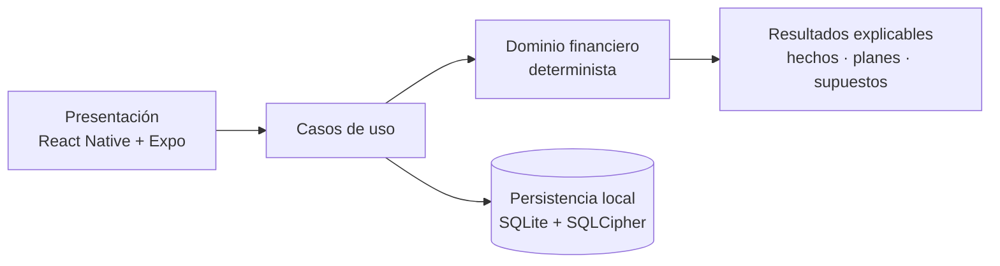

  
  <h1>AHORIS — Finanzas personales adaptativas</h1>
  
<strong>Tus finanzas, en la vida real.</strong>

  

    <a href="https://github.com/JosueLuceroG"><strong>Volver al perfil de GitHub ↗</strong></a>
  

---

> [!IMPORTANT]
> Este repositorio contiene únicamente material de presentación. El código fuente, la documentación interna y los datos del producto son privados. AHORIS se encuentra en una etapa temprana: todavía no existen pantallas de producto, prototipos visuales ni una demostración pública. Por eso, las imágenes de esta presentación son composiciones conceptuales, no capturas de la aplicación.

## El proyecto

AHORIS es una aplicación de finanzas personales para México que busca responder una pregunta más útil que el saldo: **¿qué puedes hacer con tu dinero sin romper lo que ya está comprometido ni lo que estás construyendo?**

El producto conecta ingresos, gastos, compromisos y metas en una lectura clara, y muestra las consecuencias antes de una decisión. Su dirección inicial es iPhone-first y está pensada para funcionar de forma local y privada, sin depender de un backend para el MVP.

AHORIS no es una aplicación de inversión ni sustituye la asesoría financiera profesional. Su propósito es dar contexto, explicar supuestos y ofrecer alternativas para que cada persona decida.

## La idea central

  
   
  Infografía conceptual basada en la documentación del producto. No representa pantallas ni funcionalidad implementada.

## Principios de producto

- **Contexto antes que prohibiciones.** Una decisión no se reduce a un “sí” o un “no”; importa su efecto sobre compromisos, ahorro, metas y liquidez.
- **La realidad se distingue del plan.** Hechos, proyecciones, simulaciones y datos faltantes no se presentan como equivalentes.
- **El plan se adapta.** “La vida cambia. Tu plan también.” Los reajustes son alternativas explicadas, nunca imposiciones.
- **Las cifras se explican.** Cada resultado relevante debe mostrar de dónde viene, qué supuestos usa y qué información falta.
- **La persona decide.** AHORIS no registra operaciones por inferencia ni convierte una sugerencia en una acción confirmada.
- **Un tono claro y humano.** Sin culpa, alarmismo ni lenguaje que presente la incertidumbre como certeza.

## Alcance previsto del MVP

| Módulo | Propósito |
| --- | --- |
| Disponible Real | Distinguir saldo de capacidad de gasto, considerando compromisos y partidas protegidas. |
| Gastos e ingresos | Registrar movimientos confirmados con monto, fecha, categoría y origen. |
| Meta Viva | Definir un objetivo con un plan que pueda reajustarse cuando cambie la realidad. |
| Ahorro Adaptable | Proponer alternativas sostenibles ante un desvío, sin imponer un ajuste. |
| Simulador | Mostrar el posible impacto de una compra o escenario sin registrar la operación. |
| “¿Me alcanza?” | Evaluar una decisión con el contexto disponible y declarar sus limitaciones. |
| Resumen semanal | Interpretar ingresos, gasto y ahorro con el nivel de evidencia disponible. |
| Aprendizaje | Detectar señales y recurrencias con madurez, sin afirmar patrones prematuros. |

Alcance documentado. No representa funcionalidad ya implementada.

## Estado actual

AHORIS completó su fundación documental y técnica, y validó un bootstrap mínimo de la aplicación móvil. La siguiente etapa de implementación aún no está iniciada.

| Área | Estado |
| --- | --- |
| Visión, reglas de producto y flujos | Documentados y aprobados |
| Arquitectura, seguridad y modelo de datos | Decisiones técnicas documentadas |
| Bootstrap móvil | Expo blank TypeScript instalado y validado |
| Interfaz de producto | No iniciada |
| Núcleo financiero y persistencia | No iniciados |
| Backend, autenticación y sincronización | Fuera del alcance inicial |
| Demostración pública | No disponible |

La aplicación móvil existe hoy como un proyecto Expo mínimo, sin lógica financiera, pantallas de producto ni build nativo. Este repositorio no publica ese código.

## Dirección técnica

La arquitectura objetivo separa el dominio financiero de la interfaz, la persistencia y cualquier capa de interpretación. Las simulaciones trabajan sobre un estado temporal y no modifican datos confirmados.

| Base | Dirección |
| --- | --- |
| Móvil | React Native 0.86, Expo 57 y React 19 |
| Lenguaje | TypeScript 6 |
| Estado de presentación | React Context + `useReducer` |
| Persistencia | SQLite cifrado con SQLCipher, sin backend en el MVP |
| Plataforma | iPhone-first; Android post-MVP |
| Identidad | Verde, brote de dos hojas e Inter como dirección visual |

La base móvil corresponde al bootstrap validado. El resto de la dirección técnica está aprobada, pero todavía no implementada.

## Una etapa temprana, mostrada con transparencia

La documentación del proyecto define la experiencia que se quiere construir, pero todavía no existen pantallas que puedan fotografiarse. Las dos imágenes de esta presentación son infografías editoriales creadas a partir de esa documentación y de la dirección de marca. No simulan una aplicación terminada.

El logotipo vectorial definitivo tampoco forma parte todavía de los activos del proyecto. La paleta verde, el brote de dos hojas y la tipografía Inter son una dirección aprobada, no un sistema de marca final.

## Enlaces

- [Perfil de Josué Lucero](https://github.com/JosueLuceroG)

---

  Material de presentación de AHORIS. Código fuente privado. Todos los derechos reservados.

