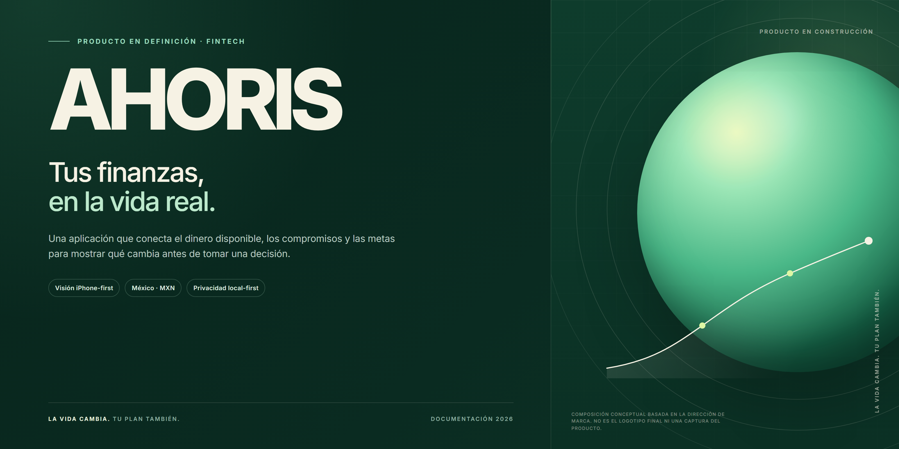
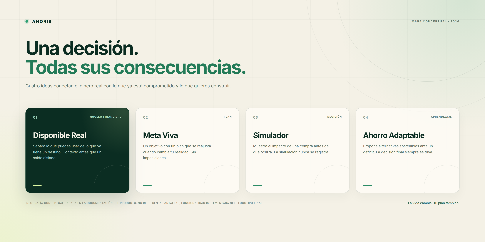
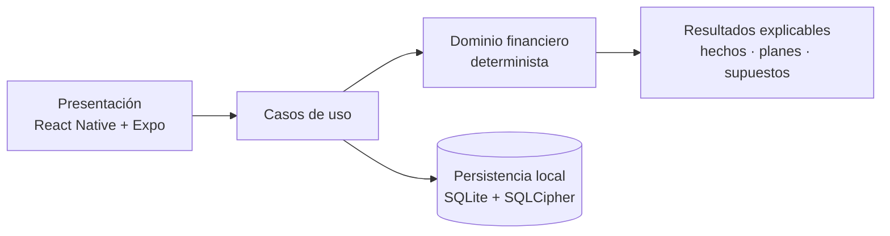

  
  <h1>AHORIS</h1>
  
<strong>Finanzas personales adaptativas para México.</strong>

  
Tus finanzas, en la vida real.

  

    
    
    
    
    
  

  

    <a href="https://github.com/JosueLuceroG"><strong>Volver al perfil de GitHub ↗</strong></a>
  

---

> [!IMPORTANT]
> AHORIS sigue en desarrollo. Este repositorio es una presentación pública del producto: no incluye el código fuente, no hay demo pública y la interfaz todavía no está implementada. Las dos imágenes incluidas son piezas de diseño reales del proyecto, no capturas de la aplicación.

## Qué es AHORIS

AHORIS es una aplicación de finanzas personales para México que busca responder una pregunta más útil que el saldo:

> **¿Qué puedes hacer con tu dinero sin romper lo que ya está comprometido ni lo que estás construyendo?**

El producto conecta ingresos, gastos, compromisos y metas en una lectura clara, y muestra las consecuencias antes de una decisión. Su dirección inicial es iPhone-first y está pensada para funcionar de forma local y privada, sin depender de un backend para el MVP.

AHORIS no es una aplicación de inversión ni sustituye la asesoría financiera profesional. Su propósito es dar contexto, explicar supuestos y ofrecer alternativas para que cada persona decida.

## La idea central

En lugar de mostrar solo cuánto dinero hay en una cuenta, AHORIS separa lo que está disponible de lo que ya tiene un destino. Así, una compra deja de ser un número aislado y se convierte en una decisión con contexto: qué compromete, qué retrasa y qué alternativas existen.

El modelo se apoya en cuatro ideas:

| Idea | Qué aporta |
| --- | --- |
| **Disponible Real** | Distingue el saldo de la capacidad de gasto, considerando compromisos y partidas protegidas. |
| **Meta Viva** | Define un objetivo con un plan que puede reajustarse cuando cambia la realidad. |
| **Simulador** | Muestra el posible impacto de una compra o escenario sin registrar la operación. |
| **Ahorro Adaptable** | Propone alternativas sostenibles ante un desvío, sin imponer un ajuste. |

## Diseño real del proyecto

Estas son las dos piezas visuales que existen hoy en el repositorio. Fueron creadas a partir de la documentación del producto y de la dirección de marca. No son pantallas de la aplicación ni representan funcionalidad ya implementada.

<table>
  <tr>
    <td width="50%" valign="top">
      
       
      <strong>Portada de presentación.</strong> Pieza real de 3200 × 1600 px. Resume la propuesta: finanzas personales, México, iPhone-first y privacidad local-first.
    </td>
    <td width="50%" valign="top">
      
       
      <strong>Mapa conceptual.</strong> Pieza real de 3200 × 1600 px. Explica las cuatro ideas que conectan el dinero disponible con los compromisos y las metas.
    </td>
  </tr>
</table>

Capturas de la app: todavía no existen. La interfaz es la siguiente etapa del desarrollo.

## Alcance previsto del MVP

| Módulo | Propósito |
| --- | --- |
| Disponible Real | Distinguir saldo de capacidad de gasto, considerando compromisos y partidas protegidas. |
| Gastos e ingresos | Registrar movimientos confirmados con monto, fecha, categoría y origen. |
| Meta Viva | Definir un objetivo con un plan que pueda reajustarse cuando cambie la realidad. |
| Ahorro Adaptable | Proponer alternativas sostenibles ante un desvío, sin imponer un ajuste. |
| Simulador | Mostrar el posible impacto de una compra o escenario sin registrar la operación. |
| "¿Me alcanza?" | Evaluar una decisión con el contexto disponible y declarar sus limitaciones. |
| Resumen semanal | Interpretar ingresos, gasto y ahorro con el nivel de evidencia disponible. |
| Aprendizaje | Detectar señales y recurrencias con madurez, sin afirmar patrones prematuros. |

Alcance documentado. No representa funcionalidad ya implementada.

## Estado real del proyecto

AHORIS completó su fundación documental y técnica, y validó un bootstrap mínimo de la aplicación móvil. La siguiente etapa de implementación aún no está iniciada.

| Área | Estado |
| --- | --- |
| Visión, reglas de producto y flujos | Documentados y aprobados |
| Arquitectura, seguridad y modelo de datos | Decisiones técnicas documentadas |
| Bootstrap móvil | Expo blank TypeScript instalado y validado |
| Piezas visuales | 2 diseños reales incluidos; no son pantallas |
| Interfaz de producto | No iniciada |
| Núcleo financiero y persistencia | No iniciados |
| Backend, autenticación y sincronización | Fuera del alcance inicial |
| Capturas de la aplicación | No disponibles todavía |
| Demostración pública | No disponible |
| Fecha pública de lanzamiento | No definida |

La aplicación móvil existe hoy como un proyecto Expo mínimo, sin lógica financiera, pantallas de producto ni build nativo. Este repositorio no publica ese código.

## Principios de producto

- **Contexto antes que prohibiciones.** Una decisión no se reduce a un "sí" o un "no"; importa su efecto sobre compromisos, ahorro, metas y liquidez.
- **La realidad se distingue del plan.** Hechos, proyecciones, simulaciones y datos faltantes no se presentan como equivalentes.
- **El plan se adapta.** "La vida cambia. Tu plan también." Los reajustes son alternativas explicadas, nunca imposiciones.
- **Las cifras se explican.** Cada resultado relevante debe mostrar de dónde viene, qué supuestos usa y qué información falta.
- **La persona decide.** AHORIS no registra operaciones por inferencia ni convierte una sugerencia en una acción confirmada.
- **Un tono claro y humano.** Sin culpa, alarmismo ni lenguaje que presente la incertidumbre como certeza.

## Dirección técnica

La arquitectura objetivo separa el dominio financiero de la interfaz, la persistencia y cualquier capa de interpretación. Las simulaciones trabajan sobre un estado temporal y no modifican datos confirmados.

| Base | Dirección | Estado |
| --- | --- | --- |
| Móvil | React Native 0.86, Expo 57 y React 19 | Bootstrap validado |
| Lenguaje | TypeScript 6 | Base del bootstrap |
| Estado de presentación | React Context + `useReducer` | Dirección aprobada |
| Persistencia | SQLite cifrado con SQLCipher | Objetivo del MVP |
| Plataforma | iPhone-first; Android post-MVP | Dirección aprobada |
| Identidad | Verde, brote de dos hojas e Inter | Dirección visual |

La base móvil corresponde al bootstrap validado. El resto de la dirección técnica está aprobada, pero todavía no implementada.

## Privacidad y límites

- **Local-first.** El MVP está pensado para funcionar sin backend y con los datos en el dispositivo.
- **Persistencia cifrada.** La dirección técnica contempla SQLite con SQLCipher.
- **Sin inferencias silenciosas.** Una simulación no registra una operación; una sugerencia no se convierte en una acción confirmada.
- **Sin asesoría financiera.** AHORIS da contexto y alternativas, no recomendaciones de inversión ni diagnósticos financieros.
- **Sin datos ficticios.** Este README no publica métricas de usuarios, testimonios ni resultados inventados.

## Qué sigue

La siguiente etapa es la implementación de la interfaz y del núcleo financiero del MVP. La persistencia local cifrada forma parte de la dirección técnica, pero todavía no está implementada.

No hay una fecha pública de lanzamiento. Cuando existan pantallas reales de la aplicación, se añadirán a este repositorio como capturas del producto, no como composiciones de presentación.

## Sobre este repositorio

- Es un escaparate público de AHORIS, no la aplicación ni su código fuente.
- El código, la documentación interna y los datos del producto son privados.
- Las imágenes son piezas de diseño reales del proyecto y se conservan aquí como material de presentación.
- El logotipo vectorial definitivo y el sistema de marca final todavía no forman parte de los activos públicos.

## Enlaces

- [Perfil de Josué Lucero](https://github.com/JosueLuceroG)
- [Portada de AHORIS](assets/ahoris-cover.png)
- [Mapa conceptual de AHORIS](assets/ahoris-concept.png)

---

  Material de presentación de AHORIS. Producto en desarrollo. Código fuente privado. Todos los derechos reservados.

